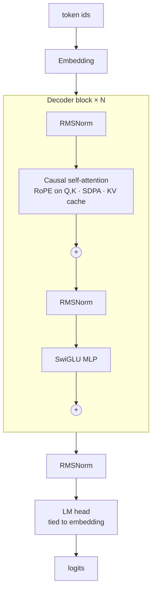

# gpt-from-scratch

**A modern GPT, built from first principles in ~450 lines of PyTorch.** Not a wrapper around a pretrained model: the tokenizer, the architecture, the training loop and the sampler are all written here, readable top to bottom.

It uses the same building blocks as Llama-class models:

- **Byte-level BPE tokenizer** trained from scratch (any language, emoji, code: never an unknown token)
- **Rotary position embeddings (RoPE)**
- **RMSNorm** pre-normalization
- **SwiGLU** feed-forward
- **Weight tying**, scaled residual init, AdamW with decoupled decay groups
- **KV-cache** generation with temperature, top-k and nucleus (top-p) sampling
- Warmup + cosine LR schedule, gradient clipping, best-checkpoint saving
- Runs on **CUDA, Apple Silicon (MPS) or CPU**, auto-detected

  

<!-- author-banner -->
> **Project 02 of 20** in my AI build series, designed and built by **[Abbishekk DGS](https://abbishekkdgs.tech)**. [See all projects →](https://github.com/Abbishekk-DGS)

## Results

The `tiny` preset trained on Tiny Shakespeare on an 8 GB Apple Silicon Mac (MPS):

| Preset | Params | Steps | Time | Val loss | Val perplexity |
|---|---|---|---|---|---|
| tiny | 0.98 M | 1,500 | 2.5 min | 3.46 | 31.8 (from 1,033 at init) |

Sample at temperature 0.8, prompt `ROMEO:`:

```
ROMEO:
What! what dost thou into base! O, why is my hand,
For that a treasure of her foe:
He is a fellow and frains, weeping the crown,
That she's a sign of highness full of best,
Whilst I am put forth to do it so.

LEONTES:
Are, I am no corn
Which he did not call his priest.
```

It learns speaker tags, line breaks, verse rhythm and archaic grammar in under three minutes. Scale up to the `small` preset (11M params) and a longer run for more coherent text.

## Quickstart

```bash
git clone https://github.com/Abbishekk-DGS/gpt-from-scratch && cd gpt-from-scratch
uv sync

uv run gpt-from-scratch prepare --vocab 1024                 # downloads Tiny Shakespeare, trains BPE
uv run gpt-from-scratch train --preset tiny --steps 1500     # ~3 min on a laptop
uv run gpt-from-scratch sample --prompt "ROMEO:" --tokens 200
```

Train on your own text (Tamil literature, your notes, source code) with `gpt-from-scratch prepare --input my_corpus.txt`.

## Architecture



## What's in the code

| File | What to read it for |
|---|---|
| `tokenizer.py` | BPE training with **incremental pair counts**: each merge only touches words that contain the pair, so training is fast enough for real corpora |
| `model.py` | RoPE, RMSNorm, SwiGLU, KV cache, top-k/top-p sampling |
| `train.py` | LR schedule, weight-decay groups, eval loop, checkpointing |
| `cli.py` | `prepare` / `train` / `sample` and the model presets |

## Tests

The tests check behaviour, not only shapes:

- the tokenizer round-trips English, Tamil and emoji exactly
- **causality**: changing future tokens never changes past logits
- **KV-cache equivalence**: incremental decoding matches a full forward pass
- generation keeps working past the context window
- a short training run reduces loss

```bash
uv sync --extra dev && uv run pytest -q
```

## Presets

| Preset | Layers | Heads | Width | Context | Params | Hardware |
|---|---|---|---|---|---|---|
| tiny | 4 | 4 | 128 | 128 | ~1 M | any CPU |
| small | 6 | 6 | 384 | 256 | ~11 M | laptop GPU / MPS |
| base | 12 | 12 | 768 | 512 | ~88 M | a real GPU |

## References

- Vaswani et al., *Attention Is All You Need* (2017)
- Su et al., *RoFormer: Rotary Position Embedding* (2021)
- Shazeer, *GLU Variants Improve Transformer* (2020)
- Touvron et al., *LLaMA* (2023)
- Sennrich et al., *Neural Machine Translation of Rare Words with Subword Units* (2016)

## About the author

Built by **Abbishekk DGS**. More of my work at **[abbishekkdgs.tech](https://abbishekkdgs.tech)** and on **[GitHub](https://github.com/Abbishekk-DGS)**.

## License

MIT © Abbishekk DGS
